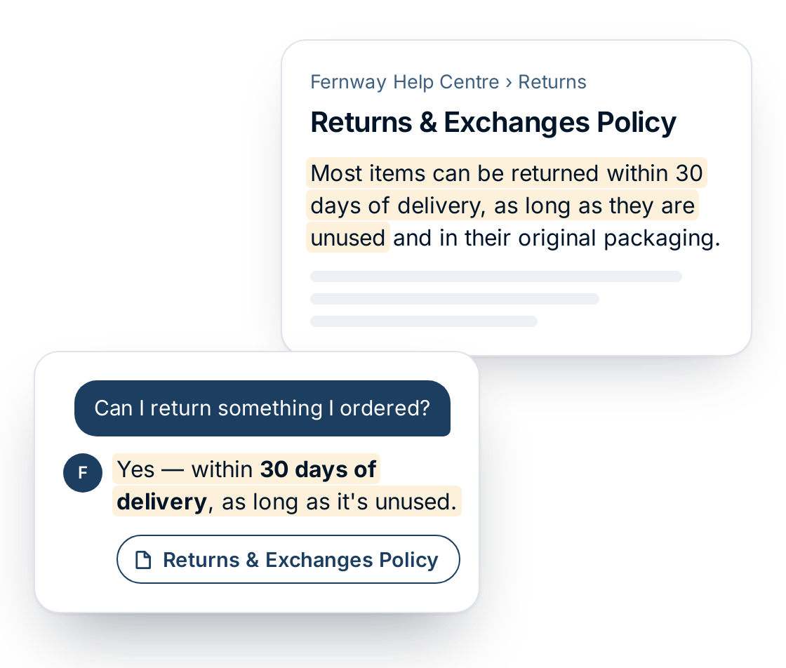

<h1 align="center">Dimitar Karaskakovski</h1>

  <b>Founder &amp; AI Engineer</b> at <a href="https://usekaras.com">Karas</a> &nbsp;·&nbsp; B.Sc. Artificial Intelligence student at JKU Linz

  
  
  
  

---

I'm an Artificial Intelligence student at Johannes Kepler University Linz who builds machine-learning systems and measures them honestly.

I founded **Karas**, an AI support agent for e-commerce that is live in production, and designed its retrieval, evaluation and safety logic. I also build classical ML and deep-learning projects with leakage-free evaluation. The work I care most about is what decides whether a model can be trusted: how it's evaluated, where it fails, and what stops it from saying the wrong thing.

---

## Featured: Karas — AI customer support, grounded in your help centre

  

**[usekaras.com](https://usekaras.com)** · Aug 2026 – present. Karas answers customer questions from a store's help centre and links the article behind each answer. It refuses rather than guesses, and it hands off to a human when it can't help. Clients install it with one `<script>` tag, and the demo on the landing page is the live product.

I designed the retrieval, evaluation and safety logic. I built the widget, servers and deployment working with a coding agent (Claude Code).

<table>
<tr>
<td align="center"><b>0.85</b> answer factuality on a 6,221-article benchmark</td>
<td align="center"><b>52% → 83%</b> right article in the top 5, keyword-only vs. vector-only</td>
<td align="center"><b>4×</b> faster retrieval, with no loss in accuracy</td>
<td align="center"><b>6.3 s → 1.8 s</b> reranking time with parallel batches</td>
</tr>
</table>

**What I designed**

- **Hybrid retrieval.** Keyword (BM25) and vector search (Voyage AI embeddings) combined with weighted reciprocal rank fusion, plus LLM query rewriting and reranking. On their own, vector search found the right article in the top 5 results 83% of the time vs. 52% for keyword search; production runs a weighted hybrid of both. Moving the fusion step into the database made retrieval 4× faster with no loss in accuracy. Scoring rerank candidates in parallel batches cut reranking from 6.3 s to 1.8 s.
- **Evaluation.** Every change is measured on the 6,221-article [WixQA](https://huggingface.co/datasets/Wix/WixQA) benchmark (hit@k, MRR, LLM-as-judge factuality). I found that the LLM grader gave full marks to 189 of 200 answers, even when the right article was never retrieved. I fixed it by grading against reference answers only.
- **Safety checks.** Rule-based guardrails block answers without a source and stop the agent from promising refunds or claiming actions it can't take.

**What it ships with:** an embeddable widget, multi-tenant API keys bound to each client's website, per-client rate limiting, handoff to a human through the client's helpdesk, and CI/CD to a self-hosted server.

  
  
  
  
  
  
  
  

The source is private because Karas is a commercial product. I'm happy to walk through the code and architecture in an interview.

---

## Machine Learning Projects

### [Satellite Terrain Classification](https://github.com/dimitar-sudo/satelite_image_classification)

A VGG-style CNN that I designed and trained **from scratch in PyTorch** (3.3M parameters, no pretrained weights). It classifies Sentinel-2 satellite tiles into 10 land-use classes and is served through an interactive Shiny web app.

- **96.93% test accuracy**, macro-F1 0.969, Cohen's κ 0.966 on a held-out split never used for training or model selection
- Flips and rotations as augmentation, since satellite images have no fixed "up". Most remaining errors are between similar-looking crop and vegetation types
- A Shiny web app classifies an uploaded tile in **about 3 ms on a CPU**

   

### [Sound Event Detection](https://github.com/dimitar-sudo/sound_event_detection_system)

Detects 15 household sounds (running water, footsteps, a door closing) second by second in 3,656 recordings from 408 people. The model is evaluated on **people it has never heard**.

- **Test PR-AUC 0.62 against 0.06 for guessing** with gradient boosting (KNN 0.49, random forest 0.57), using per-class thresholds tuned on validation only
- Found and fixed mistakes in my first evaluation: the same person's recordings were in both training and test data, which inflated the scores. It is now split by person and scored with PR-AUC instead of an inflated macro-F1
- CLI package with resumable sweeps, cached intermediates, and a README generated from saved results

     

---

## Tech Stack

| | |
|---|---|
| **Machine Learning** |       |
| **LLMs & Retrieval** |       |
| **Languages & Tools** |      |
| **Familiar with** |         |

---

## Education

**Johannes Kepler University Linz**: B.Sc. Artificial Intelligence · Oct 2025 – Jul 2028 (expected) · GPA 1.56 (1.0 = best)

Relevant coursework: Machine Learning &amp; Pattern Classification · Hands-on AI · Statistics for AI · Mathematics for AI I &amp; II · Algorithms &amp; Data Structures · Programming in Python I &amp; II

---

## Earlier Work

**Freelance Python Developer on Upwork** (Sep – Dec 2025). I wrote a tool that turns an MBOX email archive into one readable HTML page per thread. It removes repeated quoted text but keeps the quotes the sender was replying to. The client wrote that I have *"extremely rare skills as a programmer"*.

Smaller full-stack Python projects from when I started out:

| Project | What it does | Stack |
|---|---|---|
| [Smart Scheduler AI](https://github.com/dimitar-sudo/smart-scheduler-ai) | Conversational appointment booking: spaCy NER extracts names, dates and times from chat, with conflict detection and a FullCalendar UI | Flask, spaCy, pytest, CI |
| [eBay Product Finder](https://github.com/dimitar-sudo/e-commerce-app) | Searches the eBay Browse API (OAuth2) with filtering, currency conversion, caching, rate limiting, and CSV/Excel/JSON export | Flask, REST APIs, pandas |
| [S&P 500 Data Collector](https://github.com/dimitar-sudo/sp500-scraper-app) · [demo](https://sp500-scraper-app.onrender.com) | Scrapes and cleans live S&P 500 data, with CSV export | Flask, BeautifulSoup, pandas |
| [Task Master](https://github.com/dimitar-sudo/task-master) · [demo](https://task-master-demo.onrender.com) | Task manager with categories, deadlines, search/sort and dark/light themes | Flask, SQLAlchemy, SQLite |

---

## Certifications &amp; Languages

 

---

  <b>Open to AI / ML internships and working-student roles.</b> Based in Linz, Austria; open to on-site, hybrid or remote work. 
  <a href="mailto:dimitarkaraskakovski92@gmail.com">dimitarkaraskakovski92@gmail.com</a> &nbsp;·&nbsp; <a href="https://www.linkedin.com/in/dimitar-karaskakovski">LinkedIn</a> &nbsp;·&nbsp; <a href="https://usekaras.com">usekaras.com</a>

